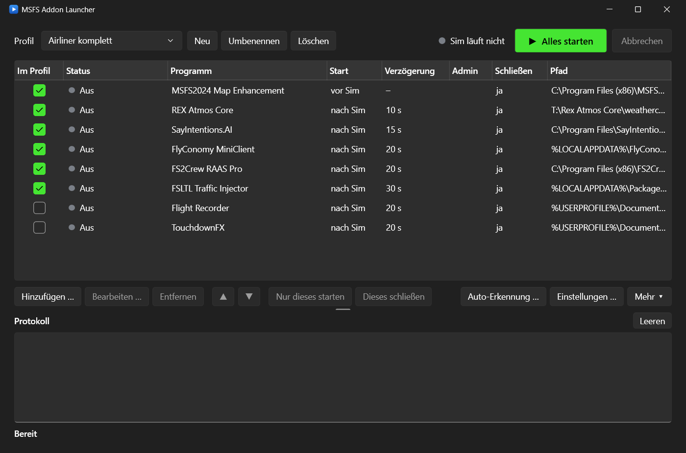

# MSFS Addon Launcher

Startet deine Zusatzprogramme und den Microsoft Flight Simulator 2024 mit einem Klick,
wartet mit Programmen, die eine Sim-Verbindung brauchen, bis der Sim bereit ist, und
schließt sie auf Wunsch wieder, wenn du den Sim beendest.

> **Early Access (Alpha), Version 0.9.1.** Frühe Testversion eines privaten Hobbyprojekts.
> Sie kann Fehler enthalten und sich jederzeit ändern. Nutzung auf eigene Gefahr, ohne
> Gewährleistung und ohne Anspruch auf Support. Details unter [Haftungsausschluss](#haftungsausschluss).



## Herunterladen und starten

1. Auf der Seite **Releases** die Datei `MSFS-Addon-Launcher.exe` herunterladen.
2. In einen eigenen Ordner legen, in dem du schreiben darfst (z. B. `Dokumente\MSFS Addon Launcher`),
   nicht unter `C:\Program Files`. Der Launcher legt seine `config.json` und den Ordner `logs`
   neben die exe.
3. Starten. Eine Installation oder .NET-Laufzeit ist nicht nötig.

Windows zeigt beim ersten Start wahrscheinlich „Der Computer wurde durch Windows geschützt",
weil die exe nicht signiert ist: **Weitere Informationen → Trotzdem ausführen**.

Beim ersten Start läuft die Ersteinrichtung: Der Launcher erkennt Store- oder Steam-Version,
sucht Zusatzprogramme auf dem PC und schlägt sie zum Anhaken vor. Übernommen wird nur, was du
anhakst; alles lässt sich später ändern.

## Was wo liegt

| Ort | Inhalt |
|---|---|
| `MSFS Addon Launcher.exe` | Das Programm (aus den Releases oder selbst gebaut im Ordner `App`). |
| `config.json` neben der exe | Deine Konfiguration. Gut lesbar, von Hand änderbar. Entsteht beim ersten Start. |
| `logs\` neben der exe | Protokolle, eine Datei pro Tag. |
| `config.beispiel.json` | Kommentiertes Beispiel mit allen Feldern. |
| `src\MsfsAddonLauncher\` | Der Quellcode. |

**Weitergeben:** Gib nur die `.exe` weiter, nicht deine `config.json`, denn die enthält die
Pfade deines PCs.

## Fehler melden

Bitte die Version (steht im Fenstertitel), was du gemacht hast und die Logdatei des Tages aus
dem Ordner `logs` mitschicken.

## Bedienung

- **Alles starten** arbeitet die Liste von oben nach unten ab: erst „vor Sim", dann der Sim,
  dann „nach Sim".
- **Reihenfolge ändern:** eine Zeile mit der Maus an die gewünschte Stelle ziehen oder ▲ und ▼
  benutzen. Ob ein Programm vor oder nach dem Sim startet, stellst du über „Bearbeiten …" ein.
- **Im Profil** (Haken in der ersten Spalte) legt fest, was im gewählten Profil startet.
- **Verzögerung** ist die Wartezeit direkt vor dem Start des jeweiligen Programms.
- **Auto-Erkennung** sucht Programme und schlägt sie vor. Übernommen wird nur, was du anhakst.
  Was der Sim (über seine `exe.xml`) oder Windows schon selbst startet, ist nicht angehakt.
  Die Liste zeigt zuerst nur erkannte Flugsim-Programme, je Programm einmal. Fehlt eins, hilft
  das Suchfeld (es durchsucht alles Gefundene) oder „Alle gefundenen Programme anzeigen".
  Was gar nicht gefunden wird, trägst du über „Hinzufügen …" von Hand ein.
- **Mehr ▾** enthält: alle Profil-Programme schließen, Desktop-Verknüpfung für ein Profil,
  `exe.xml`-Vorschau, Ordner öffnen.
- **Ein Klick vom Desktop:** „Mehr ▾ → Desktop-Verknüpfung für dieses Profil erstellen".
  Die Verknüpfung startet das Profil sofort, auch wenn der Launcher schon im Infobereich läuft.

Aufruf mit Parametern: `--start "Profilname"` startet ein Profil, `--tray` startet versteckt
im Infobereich.

## Was der Launcher nicht tut

- Er ändert keine MSFS-Dateien. Die `exe.xml` wird nur gelesen; die Vorschau ist reiner Text.
- Er läuft ohne Adminrechte. „Als Administrator" gilt pro Programm, Windows fragt dann jedes Mal nach.
- Er schließt nie Browser, den Explorer oder Steam, auch wenn ein Zusatzprogramm darin läuft.

## Selbst bauen

Voraussetzung: .NET 10 SDK. Prüfen:

```powershell
dotnet --list-sdks
```

Falls es fehlt:

```powershell
winget install Microsoft.DotNet.SDK.10
```

Zum Ausprobieren während der Entwicklung:

```powershell
dotnet run --project "src\MsfsAddonLauncher"
```

Fertige Einzel-exe erzeugen (landet im Ordner `App`, deine `config.json` dort bleibt erhalten):

```powershell
dotnet publish "src\MsfsAddonLauncher" -c Release -o "App"
```

Vorher den Launcher beenden, sonst ist die exe gesperrt. Die Einstellungen für die Einzel-exe
(64 Bit, Laufzeit eingebaut, eine Datei) stehen in `MsfsAddonLauncher.csproj`.

## Aufbau des Quellcodes

| Datei | Aufgabe |
|---|---|
| `Models\Config.cs` | Aufbau der `config.json` |
| `Services\ConfigStore.cs` | Laden, Speichern, Reparieren der Konfiguration |
| `Services\Orchestrator.cs` | Der Startablauf und die Statusanzeige |
| `Services\ProcessTools.cs` | Prozesse erkennen, starten, schließen |
| `Services\SimService.cs` | Sim finden, starten, SimConnect-Bereitschaft prüfen |
| `Services\AutoDetect.cs` | Programmsuche und Katalog bekannter Zusatzprogramme |
| `Services\ExeXml.cs` | `exe.xml` lesen, Vorschau erzeugen |
| `Services\TrayIcon.cs`, `SingleInstance.cs`, `ShortcutTools.cs`, `Log.cs` | Infobereich, Einzelinstanz, Verknüpfungen, Protokoll |
| `MainWindow`, `ProgramEditWindow`, `SettingsWindow`, `DetectWindow` | Die Fenster |

## Haftungsausschluss

Der MSFS Addon Launcher ist ein privates Hobbyprojekt im Stadium Early Access (Alpha).

- Die Software wird kostenlos und so bereitgestellt, wie sie ist, ohne Gewährleistung für
  Funktion, Fehlerfreiheit oder Eignung für einen bestimmten Zweck.
- Die Nutzung erfolgt auf eigene Gefahr. Der Autor haftet nicht für das, was das Programm auf
  deinem PC tut oder verändert: weder für Schäden, Datenverlust oder geänderte Einstellungen
  noch für Probleme mit Windows, dem Simulator, Zusatzprogrammen oder deren Online-Konten,
  und auch nicht für Folgeschäden daraus, soweit das gesetzlich zulässig ist.
- Der Launcher startet und beendet Programme auf deinem PC. Prüfe selbst, was du einträgst;
  beim Beenden können ungespeicherte Daten dieser Programme verloren gehen.
- Es gibt keinen Anspruch auf Support, Updates oder Fehlerbehebung.
- Das Projekt steht in keiner Verbindung zu Microsoft, Asobo Studio oder den Herstellern der
  Zusatzprogramme. Alle Namen und Marken gehören ihren jeweiligen Inhabern.

## Stand der Tests (Version 0.9.1)

Neu in 0.9.1 (nach der ersten Rückmeldung): Reihenfolge per Ziehen mit der Maus, Suchfeld und
„Alle anzeigen" in der Auto-Erkennung, mehr erkannte Programme (z. B. Navigraph Hub), mehrere
Verknüpfungen zum selben Programm (z. B. vPilot) werden zu einem Eintrag zusammengefasst.
Die Rechenlogik dahinter ist automatisch geprüft; das Ziehen mit der Maus und das neue Aussehen
des Erkennungsfensters sind noch **nicht von Hand ausprobiert**.

Version 0.9 war die erste Alpha-Testversion. Dort geprüft (Stand 24.11.2026): Ersteinrichtung samt
Auto-Erkennung und Übernehmen, Reihenfolge, Verzögerung, „läuft bereits", fehlende Datei,
deaktiviertes Programm, Warnung „Prozess nicht erkannt", Schließen beim Sim-Ende (automatisch
und mit Nachfrage), Hart-Beenden eines nicht reagierenden Programms, Minimieren in den
Infobereich, Zweitaufruf per Verknüpfung, SimConnect-Erkennung, Laden einer vorhandenen
`config.json`.

Das lief mit harmlosen Windows-Programmen als Stellvertreter, **nicht mit dem echten Sim**,
und nur mit der Store-Version auf einem PC; der Start der Steam-Version ist ungetestet.
Zu prüfen ist deshalb:

1. **Sim-Start:** „Alles starten" im Profil „Schnellstart". Startet MSFS 2024?
2. **Prozessname des Sims:** Zeigt der Launcher oben „Sim läuft"? Falls nicht: im Task-Manager
   unter „Details" den Namen nachsehen und in den Einstellungen eintragen.
3. **SimConnect:** Steht im Protokoll „SimConnect ist bereit"? Falls nach 240 s nur eine Warnung
   kommt, in den Einstellungen die Prüfung ausschalten und eine feste Wartezeit nehmen.
4. **Zu früh gestartet?** Meldet ein Programm „keine Verbindung zum Sim", seine Verzögerung erhöhen.
5. **Prozessnamen der Programme:** Steht eines dauerhaft auf „Nicht erkannt", obwohl es läuft,
   stimmt sein Prozessname nicht (Bearbeiten → Prozessname). Vor allem bei SayIntentions prüfen.
6. **Map Enhancement:** Funktioniert es ohne Adminrechte? Sonst „Als Administrator starten" anhaken.
7. **Sim-Ende:** Werden die Programme geschlossen? Bleibt MSFS nach dem Beenden als Prozess hängen
   (bekanntes MSFS-Problem), merkt der Launcher das Ende nicht; dann „Mehr ▾ → schließen" nutzen.
8. **„Als Administrator starten":** Die Windows-Sicherheitsabfrage ließ sich nicht automatisch
   testen. Einmal bei einem Programm anhaken und ausprobieren.
9. **Rechtsklick-Menü im Infobereich:** Es funktioniert technisch, sein Aussehen (dunkel) wurde
   aber nicht angesehen.
